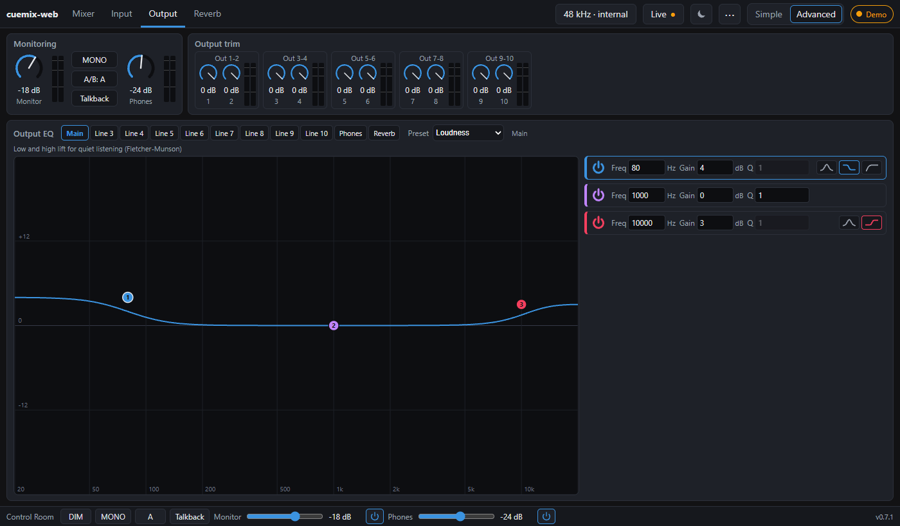

# cuemix-web

High-performance **Rust** web controller and bidirectional **OSC** bridge for the **MOTU UltraLite-mk5** audio interface. A single Rust binary embeds a dark-theme Svelte web UI and serves it together with a WebSocket API. OSC controllers (TouchOSC, QLab, ...) and browsers share one state core, so every change made from either side is applied, clamped and broadcast back to all clients.

**Status:** in daily use on a real UltraLite-mk5 (firmware 2.0.8). The device is identified on connect, its whole state is read back, levels are metered, and the mixes, preamps, trims and monitoring are controlled. The input and output EQ are written to the card; dynamics, reverb and clock are read from it, and writing them is enabled one feature at a time after a test on a card.




<sub>Screenshots taken from a real UltraLite-mk5 playing music through its optical input.</sub>

## Hardware coverage

Source of truth: [`docs/ARCHITECTURE.md`](docs/ARCHITECTURE.md) §8 (Q3) and [`docs/MOTU-PROTOCOL.md`](docs/MOTU-PROTOCOL.md). The property layouts come from a real connect dump and from CueMix 5's own property table.

- **Read and written:** preamp gain and phase (8 inputs), pad and +48 V (2 mic inputs), main volume (verified on a card), phones level, analog output trims (outputs 1–10, in the device's DAC order), mono, talkback, mix faders, pan, mute and solo (written with the layout read from the device; a stereo strip moves both halves of its pair), optical input/output format (ADAT / TOSLINK).
- **Metered:** every mixer input (after the input DSP), each preamp (before the DSP), every analog output and the phones (before the trim), S/PDIF and optical inputs. One byte per point, −0.5 dB per step, about 30 updates per second.
- **Output EQ, read and written:** 3 bands (type, on/off, frequency, gain, Q) on each of the card's EQ slots: Main, Line 3–10, Phones and the Reverb (the card has a twelfth, unused slot that is hidden and never written).
- **Input EQ, read and written:** analog inputs 1–8 (Mic 1–2, Line 3–8), 4 bands (type, on/off, frequency, gain, Q). On a stereo input pair CueMix uses the left channel's EQ; edit that one.
- **Read from the device, not written yet:** compressor (inputs 1–8), gate (mic 1–2), reverb (decay, damping, pre-delay, width, preset), sample rate and clock source. The UI shows the card's settings and says when a change is not sent yet. Reverb sends are the Reverb mix faders and the reverb return is the "Reverb" mixer input pair in every mix.
- **Detected on connect:** model, firmware, channel counts, stereo pairs and the CueMix 5 channel/mix names (the UI sizes itself to the device).
- **Known but not implemented:** routing (prop 5010: one source per output; the mixes cover normal use), A/B speakers (5015–5017), talkback settings (5026–5031), loopback source (5014). DIM has no hardware property. There is no global EQ bypass on the hardware: on/off is per band.

## Features

- Web UI for mixes, channel faders, pan, mute/solo, preamps (gain, +48 V, pad, phase), digital inputs, input DSP (EQ, compressor, gate), output trims and EQ (with presets such as *Voice clarity* or *Night*), reverb, control room and clock, with level meters everywhere.
- Presets stored on the server, plus **Export to file / Import file** to keep or share every setting as one JSON file.
- Update notice in the UI, with a user-triggered **Install**, and a **Version…** dialog to install any published release, older ones included back to the security floor (see [Updating](#updating)).
- **OSC** tab of the ⋯ Advanced settings dialog: change the OSC listen address and the feedback targets live, without editing `config.toml` or restarting (see [OSC settings](#osc-settings)).
- Bidirectional OSC over UDP `:8000` with 1-based indices (TouchOSC / QLab friendly), with feedback to every controller.
- One state core: all changes go through a single `Param` type, are clamped, then broadcast to Web and OSC clients. The engine never echoes a change back to the client that sent it.
- Native units in state, presets and JSON (`gain` for mix faders, `db` for main, phones and preamps). The `0..1` fader position exists only at the edges: OSC and the UI fader.
- Hardware-priority sync: on (re)connection the device pushes its full state, which is applied and broadcast. The server never writes its own state back to the device on reconnect.
- Per-parameter throttle toward the device (40 msg/s by default, last value always sent).
- Device discovery: explicit IP, then mDNS (provisional), then the ARP table plus a TCP probe.
- Offline demo mode when the device is absent, plus presets and channel labels.
- Single binary with the UI embedded (`rust-embed`), running as non-root.

## Build from source

Prerequisites:

- Rust **1.85** or newer (MSRV, edition 2021)
- Node.js **22**
- GNU `make` (optional, but the recommended entry point)

**Build the frontend before cargo.** The binary embeds `frontend/dist/` at compile time, and `cargo build` does not build the UI for you. Always run the frontend build first, or use `make`, whose targets enforce the order.

```sh
make frontend          # cd frontend && npm ci && npm run build  -> frontend/dist/
cargo build --release  # or simply: make backend (depends on frontend)
```

Without make:

```sh
cd frontend && npm ci && npm run build && cd ..
cargo build --release
```

### Make targets

| Target | What it does |
|---|---|
| `make` / `make all` | Build the frontend, then the release backend |
| `make frontend` | Build the Svelte UI into `frontend/dist/` |
| `make backend` | Build the frontend, then `cargo build --release` |
| `make test` | Build the frontend, then `cargo test --workspace` |
| `make lint` | Build the frontend, then `cargo fmt --check` and `cargo clippy --all-targets --locked -- -D warnings` |
| `make fmt` | `cargo fmt --all` |
| `make check-secrets` | Run `gitleaks detect` against the repository |
| `make clean` | Remove `target/`, `frontend/dist/` and `frontend/node_modules/` |
| `make help` | List all targets with their descriptions |

## Configuration

Copy the example and adjust it locally:

```sh
cp config.example.toml config.toml   # config.toml is git-ignored
```

Config file search order (first match wins):

1. `--config <path>` on the command line
2. `$CUEMIX_CONFIG`
3. `./config.toml`
4. `/etc/cuemix-web/config.toml`

A missing file means built-in defaults (zero-config start). An invalid file is an error; an unknown key is logged as a warning at startup (so typos are visible, and an older binary still starts with a newer config).

Environment overrides:

| Variable | Overrides |
|---|---|
| `CUEMIX_CONFIG` | Path of the config file (step 2 above) |
| `CUEMIX_HTTP_BIND` | `[network] http_bind` (HTTP/WebSocket listen address) |
| `CUEMIX_OSC_LISTEN` | `[network] osc_listen` (UDP OSC listen address; a saved `osc.json` wins, see [OSC settings](#osc-settings)) |
| `CUEMIX_MOTU_IP` | `[motu] ip` (device address; empty means auto-discovery) |

Main sections of `config.example.toml`: `[network]` (listen addresses, feedback targets, MOTU interface, mDNS name), `[motu]` (device IP and WebSocket port), `[engine]` (throttle, sync policy, offline fallback), `[storage]` (presets and labels paths), `[web]` (trust of `X-Forwarded-*` headers), `[measure]` (room test, see below).

## Room test

The UltraLite has no noise generator, so the test noise comes from your own MPD / myMPD server. Wire its analog output to a MOTU line input (default: Line 7-8, mixer inputs 6 and 7), then add to `config.toml`:

```toml
[measure]
mpd = "192.0.2.20:6600"          # MPD protocol address (plain TCP)
# mpd_password = ""              # if MPD has one; keep it out of tracked files
# noise_url = ""                 # default: this server as seen from MPD, port of http_bind
# source_inputs = [6, 7]         # 0-based mixer inputs carrying the MPD signal
# max_seconds = 60               # watchdog, 20-80
```

How it works: a "Room test" button (phone view) or "Measure room..." (Output EQ) opens the test. The server saves the Main mix mutes and solos, the Main output EQ and the source inputs' EQ, mutes every other input, flattens those EQs (through the normal write path, so the card and every open page follow), then has MPD play `GET /api/measure/noise.wav` (pink noise, about -20 dBFS). The phone records it with its microphone; the browser analyses the room response and proposes up to three Main output EQ cuts below 500 Hz, which you can apply and undo. If MPD is playing, the server pauses it first (you do not need to), and the room stays quiet for 3.5 s so the phone can record the background; then the noise starts. The test also stops if the browser page that started it disconnects (closing or reloading it, losing the network); other pages disconnecting change nothing. When the test ends, fails, is stopped, or after `max_seconds`, everything is restored exactly (inputs that were already muted stay muted) and MPD goes back to what it was playing (same song, position, paused or stopped, repeat/random/single/consume). Mutes are written before unmutes, so no input is briefly heard that should not be. The mixer values to put back are saved to `measure-restore.json` (next to `labels.json`) before anything changes and kept until the card has received them: if the MOTU link drops, the MOTU is unplugged or the service stops or crashes during a test, the mixer is restored as soon as the MOTU is online again (also after a restart). After a crash, MPD is not restored (the noise ends by itself after 90 s and stays in the queue). Values you change yourself during a test (mutes, solos, those EQ bypasses) are overwritten by the restore. Only one test runs at a time; any open page can stop it. Pause your music before starting: the phone first records 3 s of room background.

Limits: a phone microphone is not a measurement microphone. Below about 50 Hz and above about 500 Hz its response is not reliable for this purpose, so only cuts of room modes in 30-500 Hz are proposed, never boosts. Keep Main at your usual listening level, put the phone at the listening position, microphone pointing up. The browser only gives microphone access on a secure origin: serve the UI over HTTPS (reverse proxy) or open it from `localhost`. MPD must be able to reach this server over HTTP (and needs its HTTP input plugin); the noise URL is not authenticated.

## Running

```sh
cuemix-web --config config.toml          # or: cargo run --release -- --config config.toml
RUST_LOG=debug cuemix-web --config config.toml   # default level is info
cuemix-web --help                        # usage and environment variables
cuemix-web --version
```

Once running:

- Web UI: `http://127.0.0.1:8080`, or `http://cuemix-web.local:8080` when mDNS is available on the network.
- Health check: `curl http://127.0.0.1:8080/api/health` returns `{"status":"ok","version":…}`.
- OSC: UDP `:8000`.
- Without a MOTU on the network, the server starts in **demo mode**: state is kept in memory and commands are accepted but not sent to any device.
- Presets and labels are stored under `[storage]`. The example points to `/var/lib/cuemix-web/`, so create that directory or change the paths in `config.toml`.

## Web UI

The embedded Svelte 5 console (dark theme) has four views, each reachable directly with a URL fragment (`#mixer`, `#input`, `#output`, `#reverb`; changing the fragment or using Back on an open page switches the view):

- **Mixer**: one tab per mix (Main 1-2, Phones, Line 3-4 … Reverb, in CueMix 5 order), one strip per input or stereo pair (pan, fader, meter, mute/solo, DSP drawer on the analog inputs), grouped under Mic, Line, S/PDIF, Optical, Computer and Reverb headings, and the Monitor (Main volume) fader with a dB scale and the selected mix's output meter.
- **Input**: mic and line preamps with their meters, S/PDIF and optical inputs (ADAT/TOS).
- **Output**: monitor and phones levels, mono, A/B, talkback, output trims per pair, and the output EQ (curve on the left, bands on the right, presets).
- **Reverb**: reverb settings, sends (the Reverb mix) and returns.

On a phone the UI opens in a **Simple** view: two large rotary knobs, Monitor (Main) and Phones, each with vertical meters (drag up or right for more; arrow keys and the wheel move 1 dB; no double-tap reset; most of the travel covers the top 40 dB, like the sliders; an off channel reads "Off" with the level On brings it back to, and turning its knob then changes that level without switching it on), a Main on/off button that fades the Main volume out and back in over about a second (the server runs the fade, so every device sees it, and remembers the level it goes back to, never above it), and preset recall (the Preset row opens a list with a Load button per preset and shows "● Modified" when the sound no longer matches it). During a fade the on/off button shows a moving bar; with a speaker plug it turns amber and counts down the warm-up. Meters have ticks at −40, −18 and −6 dBFS and a red clip mark that a tap clears. **Keep screen on** (where the browser supports it) stops the phone from sleeping while the Simple view is in front; it is off by default and remembered per browser. The **Simple | Advanced** switch in the header (two icons on phones) shows the current view and opens the full console (which also fits phone and tablet screens); the choice is remembered per browser. In demo mode (no MOTU found) the header shows an amber **Demo** label. Error messages stay until you tap them; notices disappear after 5 seconds. On phones the Advanced view has a bottom tab bar (Mixer, Input, Output, Reverb, the same order and names as the planned iOS app), and the Control Room bar shows Monitor and Phones, each with its own on/off button; DIM, MONO, A/B and Talkback are under its ⋯ button.

### Add to the iPhone home screen

Open the UI in Safari, tap **Share**, then **Add to Home Screen** (name: Cue Desk). The icon opens the UI full screen like an app, straight in the Simple view. The home-screen app has its own storage, separate from Safari: the view choice starts empty. The remembered Main on/off level lives on the server and is shared by every device.

URL flags (never saved): `?simple` forces the Simple view for that page load; `?embed` (for a native app's web view) opens the Advanced view and hides the Simple/Advanced toggle and the connection dot, and `?embed&simple` opens Simple. When you unlock the phone or switch back to the page, it reconnects at once if the connection was lost; if it still looks connected but no message arrives within 2 seconds (online or demo), it drops that connection and reconnects.

The DSP drawer and the output EQ follow CueMix 5: a curve with draggable bands, and per band an on/off button, frequency, gain, Q and the filter types the hardware offers on that band. Faders: double-click/tap resets to 0 dB, Shift-drag is fine adjustment, mouse wheel nudges. Controls whose changes are not sent to the MOTU yet (compressor, gate, clock, Dim, Speaker A/B) are greyed out and disabled, with a tooltip saying why; the Reverb tab is hidden while a MOTU is connected until reverb can be written. A diagnostic **Meter probe** view (`/?probe`) shows the card's raw meter points.

```sh
cd frontend && npm install
npm run dev      # Vite dev server, proxies /ws and /api to 127.0.0.1:8080
npm test         # vitest (incl. protocol.ts against design/vectors/protocol.json)
npm run check    # svelte-check
npm run build    # outputs frontend/dist (embedded into the binary)
```

## OSC quick reference

UDP `:8000`. **Indices are 1-based on the wire** (the server converts them to 0-based internally).

| Address | Argument | Parameter (conversion) |
|---|---|---|
| `/mix/{bus}/ch/{ch}/vol` | float `0..1` | `mix_vol` → `gain = (p/0.75)^K`, K ≈ 4.8024; `0.75` = 0 dB, `1.0` = +12 dB |
| `/mix/{bus}/ch/{ch}/pan` | float `-1..1` | `mix_pan` (not mapped to hardware yet) |
| `/mix/{bus}/ch/{ch}/mute` · `/solo` | int/float/bool | `mix_mute` · `mix_solo` |
| `/mix/main/vol` | float `0..1` | `main_vol` → `db` (trim: `1.0` = 0 dB, `0` = −100 dB) |
| `/preamp/{ch}/gain` | float dB `0..74` | `preamp_gain` (`db`) |
| `/preamp/{ch}/48v` · `/pad` · `/phase` | int | `phantom` · `pad` · `phase` |
| `/eq/{ch}/band/{b}/mode` · `/bypass` | int | `input_eq_mode` (0 bell, 1 low shelf, 2 high shelf, 3 high-pass; band 1: 0/1/3, bands 2–3: 0, band 4: 0/2, others refused) · `input_eq_bypass` (1 = bypassed); `ch` 1–8, `b` 1–4 |
| `/eq/{ch}/band/{b}/freq` · `/gain` · `/bw` | float | `input_eq_freq` (Hz) · `input_eq_gain` (dB) · `input_eq_bw` (Q, 0.45–10) |
| `/output/{n}/eq/band/{b}/mode` · `/bypass` · `/freq` · `/gain` · `/bw` | int / float | `output_eq_*`, same units; `n` = EQ slot 1–12 (1 Main, 3–10 Line 3–10, 11 Phones, 12 Reverb; 2 unused), `b` 1–3 |
| `/comp/{ch}/bypass` | int | `comp_bypass` (1 = bypassed); `ch` 1–8 |
| `/comp/{ch}/threshold` · `/attack` · `/release` · `/ratio` · `/makeup` | float | `comp_*`: dB · ms · ms · `n:1` · linear gain (1.0 = 0 dB) |
| `/gate/{ch}/bypass` · `/threshold` · `/attack` · `/release` | int / float | `gate_*` (1 = bypassed, dB, ms, ms); `ch` 1–2 |
| `/reverb/decay` · `/damping` · `/predelay` · `/width` | float `0..100` | `reverb_decay` · `reverb_damping` · `reverb_predelay` (ms) · `reverb_width` |
| `/reverb/preset` | int | `reverb_preset` (raw number) |
| `/clock/rate` | int Hz | `sample_rate` (44100 … 192000) |
| `/clock/source` | string | `clock_source`: `internal`, `spdif`, `optical` |
| `/routing/in/{in}/out/{out}` | int | `route` |
| `/controlroom/dim` · `/mono` · `/ab` · `/talkback` | int | `dim` · `mono` · `speaker_b` · `talkback` |
| `/controlroom/phones/vol` | float `0..1` | `phones_vol` (trim; extension to the original spec, needed by the Control Room bar) |
| `/output/{n}/trim` | float `0..1` | `output_trim` of analog output `n` (1–10; trim law like the phones) |
| `/preset/load` | string | `load_preset`, by name |
| `/sync` | none | the bridge replies with a full feedback dump to the sender (rate-limited to 1/s) |

Bridge behaviour:

- Any peer that sends a valid message is registered (TTL 10 min, max 64 peers) and receives a **full state dump** on its first message.
- Feedback (`changed`) goes to the configured feedback targets and registered peers, **except the sender** (no echo).
- Bundles are split at 8 KiB.
- Not sent over OSC: `presets`, `labels`, `meters`, `status`, `session`, `error`.

### OSC settings

**⋯ → OSC** (Advanced settings) sets where the bridge listens and who receives feedback. Changes apply immediately and are saved to `/var/lib/cuemix-web/osc.json` (`[storage] osc_file`), which then overrides `[network] osc_listen` and `osc_feedback_targets` (and `CUEMIX_OSC_LISTEN`); delete the file to go back to `config.toml`.

- **Listen**: `host:port` such as `0.0.0.0:8000`; the host is `0.0.0.0`, `::`, a loopback address or an address of this machine; the port is 1024–65535. The server binds the new socket first: if that fails (port in use, address not on this machine) the old one keeps listening and the UI shows the error. Peers that were registered by their messages are forgotten after a change of listen address and register again when they write to the new port.
- **Targets**: up to 8 of `ip:port`, `[v6]:port` or `name:port` (port 1–65535). Every resolved address must be private, link-local or loopback (the same rule as the speaker plug). A target that is added right away receives a full state dump; one that is removed stops receiving feedback. Names are resolved when the settings are applied and at startup.
- If the saved file is unreadable, invalid or cannot be bound at startup, the server logs a warning, uses `config.toml` and shows the reason in the OSC dialog. A target *name* that does not resolve yet (network not up at boot) does not discard the saved settings: the listen address and the other targets are kept, the reason is shown, and the name is tried again every minute (it receives a full dump once it resolves). A failed live change is shown the same way until the next one succeeds.
- Non-finite floats (NaN, inf) are rejected before conversion. Index `0`, a non-numeric index, or an out-of-range index is rejected.

Boolean inputs accept `int` (non-zero is on), `float` (`>= 0.5` is on), or `T`/`F`. Feedback sends booleans as `int` 0/1 and continuous values as `float`.

## WebSocket JSON quick examples

Endpoint `/ws`. Indices are **0-based** in JSON, and values use the native units:

- mix fader `gain`: linear, `0.0..=3.98107` (+12 dB), `1.0` = 0 dB
- `db` for main and phones: integer `-100..=0`
- `db` for preamp gain: integer `0..=74`
- `value` for pan: `-1.0..=1.0`

```json
{"cmd":"set","param":"mix_vol","bus":0,"ch":3,"gain":1.0}
{"cmd":"set","param":"main_vol","db":-12}
{"cmd":"set","param":"preamp_gain","ch":0,"db":30}
{"cmd":"set","param":"phantom","ch":0,"on":true}
{"cmd":"load_preset","name":"live"}
{"cmd":"save_preset","name":"live"}
{"cmd":"import_preset","name":"from file","text":"{\"schema_version\":2,\"state\":{…}}"}
{"cmd":"list_presets"}
{"cmd":"set_label","ch":2,"label":{"name":"Vox","color":"#06B6D4"}}
{"cmd":"measure_start"}
{"cmd":"measure_stop"}
```

On connection the server sends `snapshot`, `labels`, `presets` and `measure`. Later events:

```json
{"event":"changed","params":[{"param":"dim","on":true}]}
{"event":"status","connection":"online"}
{"event":"session","active_preset":"live","modified":true,"connection":"online"}
{"event":"presets","names":["default","live"]}
{"event":"labels","channels":{"2":{"name":"Vox","color":"#06B6D4"}}}
{"event":"meters","levels":[0.0,0.12]}
{"event":"measure","state":"playing","source":[6,7],"until":"2026-11-16T20:15:30Z"}
{"event":"error","message":"..."}
```

`meters` is limited to 60 per second per client. Incoming messages are capped at 256 KiB. `import_preset` stores the JSON it carries (the preset file format, any readable version) as `<name>.json`, then recalls it like `load_preset`. The server does not send a `changed` back to the client that caused it.

## Deployment

Release assets (`v*.*.*` tags) are built by `.github/workflows/release.yml`: static musl tarballs `cuemix-web-<tag>-<target>.tar.gz` and `.deb` packages, each with a `.sha256`, for `x86_64`, `aarch64` and `armv7` musl targets. Run the setup scripts from a checkout of this repository, as root.

- **Proxmox VE (LXC)**: `sudo deploy/proxmox-setup.sh`. Creates a Debian 12 container with a LAN address and an isolated MOTU bridge (no gateway, container side `169.254.254.1/16`), installs the latest release, and enables the `cuemix-web` service. Optional answers can go in `deploy/proxmox.env` (copy `deploy/proxmox.env.example`). Use `--dry-run` to preview. The bridge is defined in `/etc/network/interfaces.d/cuemix-motu.cfg`; if `/etc/network/interfaces` does not load it, the script offers to append `source /etc/network/interfaces.d/cuemix-motu.cfg` (keeping a backup) and stops if you decline. The MOTU USB link is attached to that bridge by a udev rule when it is plugged in, and again by the bridge's `post-up` hook after every host network reload (`ifreload -a` or "Apply Configuration" in the Proxmox GUI detaches bridge ports that are not declared in `/etc/network/interfaces`). A systemd timer (`cuemix-motu-bridge.timer`) also re-attaches it every 30 s if anything detaches it, and NetworkManager, if the host runs it, is told to leave the link unmanaged (it would otherwise run DHCP on it and its re-activations detach the link from the bridge).
  - *Troubleshooting: the UI says "Demo — no MOTU" while the MOTU is plugged in.* On the host, `bridge link show` should list the MOTU interface (`enx…`, MAC-based name) with `master vmbr2` (your MOTU bridge). If it is missing, re-attach it with `/usr/local/sbin/cuemix-motu-bridge --all` (or `/usr/local/sbin/cuemix-motu-bridge enx…`), then re-run `sudo deploy/proxmox-setup.sh --update` so the post-up hook is installed. The link is normally re-attached automatically within 30 s; see the re-attach events with `journalctl -u cuemix-motu-bridge`. Host-side changes (helper, udev rule, timer) only arrive with `sudo deploy/proxmox-setup.sh --update`: the in-app updater only updates the container.
- **Raspberry Pi / SBCs / Linux**: `sudo deploy/linux-setup.sh`. Detects the architecture, installs the release (binary taken from the `.deb` on Debian/Ubuntu, from the tarball otherwise), creates the `cuemix` service user, and sets up the systemd unit and the udev rule that gives the MOTU link `169.254.254.1/16`. Settings can go in `deploy/linux-setup.env`. `--uninstall` removes the installed pieces but keeps `/etc/cuemix-web` and `/var/lib/cuemix-web`.
- **Docker**: `deploy/docker-compose.yml` uses **host networking**, which the link-local discovery and OSC UDP require. Images are multi-arch and run as the distroless `nonroot` user.
- **Reverse proxy**: the `/ws` WebSocket needs an upgrade-aware proxy. Forward `X-Forwarded-For` and `X-Forwarded-Host` (used for the client address and the Origin check), and set `[web] trust_forwarded_headers = true` and `allowed_origins` in `config.toml`. If the proxy passes the `Host` header through unchanged, neither setting is needed. The server only answers for host names an outside site cannot own (IP addresses, `localhost`, `*.local`, the mDNS name); list any other name the UI is reached by (the proxy's public name, a router DNS name) in `[web] allowed_hosts`, or requests get **421**.
- **HTTPS**: cuemix-web serves plain HTTP only (by design); terminate TLS at the reverse proxy. The UI switches to `wss://` by itself when loaded over `https://`. Two common pitfalls: the proxy's backend must **not** use TLS towards cuemix-web (e.g. HAProxy "Encrypt(SSL)" unchecked), and idle WebSockets need a long tunnel timeout (HAProxy: `timeout tunnel 1h`), otherwise the UI reconnects every ~30 s.

Both scripts are idempotent: an existing `config.toml` is never overwritten. The service is `deploy/cuemix-web.service`, and the udev rule template is `deploy/99-motu-mk5.rules.template`.

## Updating

Updates are never automatic. The running version is shown at the bottom right of the web UI and by `cuemix-web --version`. Release notes: [GitHub Releases](https://github.com/lejeanf/cuemix-web/releases) and [`CHANGELOG.md`](CHANGELOG.md).

**From the web UI.** The setup scripts install two small root systemd units next to the service. `cuemix-update-check.timer` checks GitHub every hour and writes the result, with the list of the newest releases, to `/var/lib/cuemix-web/update-status.json`. When a newer release exists, the Advanced view shows **vX available** next to the version (the page re-reads the result every 10 minutes and on reconnect; `pct exec <CTID> -- systemctl start cuemix-update-check.service` checks right away), with the release notes and an **Install** button. Pressing it only writes `/var/lib/cuemix-web/update-request` (empty, or one release tag); `cuemix-update-request.path` sees that file and runs `cuemix-update --run-request` as root, with every safety check below, and the page reconnects to the new version. The web service itself stays unprivileged and never downloads anything.

**Choosing a version.** **⋯ → Version** (Advanced settings) lists the releases (pre-releases only when the switch is on), marks the installed and the latest one, and has an **Install** button per row. Installing an older release is allowed down to the **security floor** (currently v0.7.2) and goes through the same checks (sha256, health check, automatic rollback); the UI warns that settings added after that version (for example the speaker plug) stop working until you update again. Releases older than the floor would bring back a security hole or a serious bug: neither the UI nor the root updater installs them (only `sudo cuemix-update --version vX.Y.Z --force` from a root shell does). The newest release publishes its floor (`min-version` asset), so installed updaters pick up a higher one without being reinstalled. The request file is treated as untrusted input by the root side: read once, at most 64 bytes, one tag matching `vX.Y.Z[-pre]` (at or above the floor) or nothing, never passed through a shell, and the web service only writes tags found in the status file's release list. A second install within 30 s of the first is refused (429).

**Pre-releases** are a switch in the Version dialog, saved server-side in `/var/lib/cuemix-web/update-prefs.json` (`[storage] update_prefs_file`). It affects only what the UI offers (the update notice and the list); the root-side updater never reads it, and an install request always names its tag. Nothing is installed without a click. Until the switch has been saved once, `[update] channel` gives its default:

```toml
[update]
channel = "stable"        # published releases (vX.Y.Z)
# channel = "prerelease"  # newest release, alphas/betas included (vX.Y.Z-alpha.N)
```

**Existing installs need one refresh.** The in-app updater replaces the binary only; `cuemix-update` and the systemd units are installed by the setup scripts. After updating from 0.6.x to 0.7.0 through the UI, the version list stays hidden (the UI keeps its plain **Install**) until you refresh them once: Proxmox VE, on the host, `sudo deploy/proxmox-setup.sh --update`; Raspberry Pi / Linux, in your checkout, `sudo deploy/linux-setup.sh --refresh-updater`.

**From a shell.** **Raspberry Pi / Linux** (installed by `linux-setup.sh`):

```bash
sudo cuemix-update --check      # installed vs latest; exit 10 if an update is available
sudo cuemix-update              # install the latest stable release
sudo cuemix-update --pre        # include release candidates
sudo cuemix-update --version v0.3.0   # pin an exact version (up or down)
sudo cuemix-update --rollback   # go back to the previous binary
```

**Proxmox VE** (from the host, in your checkout): `sudo deploy/proxmox-setup.sh --update` (same `--pre` / `--version` flags, `--ctid N` to pick the container). It refreshes `cuemix-update` and the update units inside the container, then updates the binary. On the host it also refreshes the MOTU helper, udev rule and bridge post-up hook (no network reload); bridges and the container config are not changed. Inside the container, `cuemix-update` works as above (`pct exec <CTID> -- cuemix-update`).

**Docker**: `docker compose pull && docker compose up -d` (or pin a version tag such as `ghcr.io/lejeanf/cuemix-web:0.3.0` in `docker-compose.yml`). `latest` only follows stable releases.

How an update stays safe:

- The download is verified (sha256) and the new binary must report the expected version before anything is replaced.
- The binary is swapped atomically; the previous one is kept as `/usr/local/bin/cuemix-web.prev`.
- After the restart, `/api/health` must answer with the new version within 15 s — otherwise the previous binary is restored automatically and the last service logs are printed.
- `config.toml`, presets and labels are never touched. Presets carry a format version: presets saved by older versions keep loading; a preset saved by a newer version is refused with a clear message (after a rollback) instead of being misread. Unknown keys in `config.toml` (e.g. written for a newer version) are logged as warnings, not fatal.

`cuemix-update` exit codes: `0` updated or already up to date, `10` update available (`--check`), `1` error (nothing changed), `2` usage error, `4` another update is running, `5` update failed and was rolled back, `6` rollback failed (manual attention needed).

## Security

- Never commit `config.toml`, `*.local.toml`, `deploy/*.env`, `.env`, keys, or `data/` contents (labels and presets). All are git-ignored, and `make check-secrets` / CI run gitleaks with a rule that blocks RFC1918 addresses.
- Committed examples use only `192.0.2.x` (documentation range), `127.0.0.1`, and link-local `169.254.x.x`. Put real addresses only in local, git-ignored files.
- Input is validated at every entry point (HTTP bodies, WebSocket and OSC commands, preset names, speaker plug URLs, OSC addresses): strict allowlists, size limits, no control characters, and wrong types are refused (unknown JSON fields too, in update requests and plug/OSC settings). Details in `docs/ARCHITECTURE.md` §6.
- The server runs as a non-root user, and production code avoids `unwrap`/`expect` (enforced by a clippy lint).
- DNS-rebinding guard: requests must name a known host (IP address, `localhost`, `*.local`, the mDNS name, or `[web] allowed_hosts`), otherwise 421. Cross-site `Origin` headers are refused on `/ws`, `/api/v1/*` and `/api/update*`.
- Every response carries a Content-Security-Policy (scripts from this server only, no framing), `X-Frame-Options: DENY`, `X-Content-Type-Options: nosniff` and `Referrer-Policy: no-referrer`.
- By default there is no login: anyone who can reach the port controls the mixer and can install a release (never one below the security floor). Keep the server on a trusted network, behind an authenticating reverse proxy, or turn on the admin token below.
- **Admin token** (optional): set `[web] admin_token = "auto"` and restart. The server creates a token in `/var/lib/cuemix-web/admin-token` and logs a pairing link once; print it again as root with `cuemix-web --config /etc/cuemix-web/config.toml --pair-link` (in a Proxmox container: `pct exec <CTID> -- cuemix-web --config /etc/cuemix-web/config.toml --pair-link`). Open that link on each phone or laptop that may install updates or change the speaker plug and OSC settings; other devices see those controls read-only, while faders, presets and power stay open to everyone. The link's host name can be replaced by the server's IP; keep the `#pair=…` part. To revoke every device, delete the token file and restart (a new one is created). Scripts send `Authorization: Bearer <token>`.
- Resource limits: 10 s to send request headers, 256 HTTP connections, 64 WebSockets (16 per client address), 200 presets. OSC datagrams from outside the local network are ignored.
- The service runs in a tight systemd sandbox (`systemd-analyze security cuemix-web`: about 1.4); the root update units may only write the binary and the two state directories.
- The root updater never runs a downloaded binary as root: its `--version` check runs as `nobody`.
- Releases are signed (minisign); the installers and `cuemix-update` only install files signed by the project key under their exact name (see [Releases](#releases-maintainers)). Release jobs that run third-party build code get a read-only token, and release builds use no caches.
- The web UI's npm packages are build-time only, and npm never runs their install scripts (`frontend/.npmrc` sets `ignore-scripts=true`; CI also passes `--ignore-scripts`). CI audits both dependency trees (`cargo audit`, `npm audit`).

### Releases (maintainers)

Every release file is signed with [minisign](https://jedisct1.github.io/minisign/). The installers and `cuemix-update` refuse any download that is not signed by the key in [`deploy/minisign.pub`](deploy/minisign.pub) under its exact file name (tag and architecture included), so a release changed after the fact, or a file passed off under another name, is never installed. One-time setup:

1. Generate the key pair on your own machine, with a password: `minisign -G -p minisign.pub -s cuemix-release.key` (Debian 12 or Ubuntu 23.04 and newer: `apt install minisign`). Keep `cuemix-release.key` and its password offline as a backup.
2. Commit `minisign.pub` as `deploy/minisign.pub` and put its second line in `MINISIGN_PUBKEY` in `deploy/cuemix-update.sh` (CI checks they are equal).
3. In GitHub: **Settings → Environments → New environment** `release`, add yourself as **required reviewer**, limit deployments to tags `v*`, and add two environment secrets: `MINISIGN_SECRET_KEY` (the whole content of `cuemix-release.key`) and `MINISIGN_PASSWORD`.

The release workflow then pauses at **Sign release files** until you approve it. Only that job can read the key: it runs no third-party build code and checks every signature against `deploy/minisign.pub` before anything is published. Changing the key later means shipping the new public key in `cuemix-update.sh` first (through `proxmox-setup.sh --update` / `linux-setup.sh`), since installed updaters only trust the key they were installed with.

`minisign` is not packaged for Ubuntu 22.04; there, install it from the upstream release before running `deploy/linux-setup.sh`.

## Documentation

- [`docs/ARCHITECTURE.md`](docs/ARCHITECTURE.md) (in French): living technical source of truth covering module map, contracts, protocol details and decision log. Structural changes must update it together with this README.
- [`docs/MOTU-PROTOCOL.md`](docs/MOTU-PROTOCOL.md) (in French): hardware protocol findings, from a real connect dump, meter-probe sessions and CueMix 5's property table; open questions are listed there and in ARCHITECTURE §8.
- [`docs/CUEMIX-CAPTURE.md`](docs/CUEMIX-CAPTURE.md): how to capture CueMix 5's traffic, for anything still unknown.
- [`docs/HANDOFF.md`](docs/HANDOFF.md): original project specification (v12.0.0).

## License

MIT
