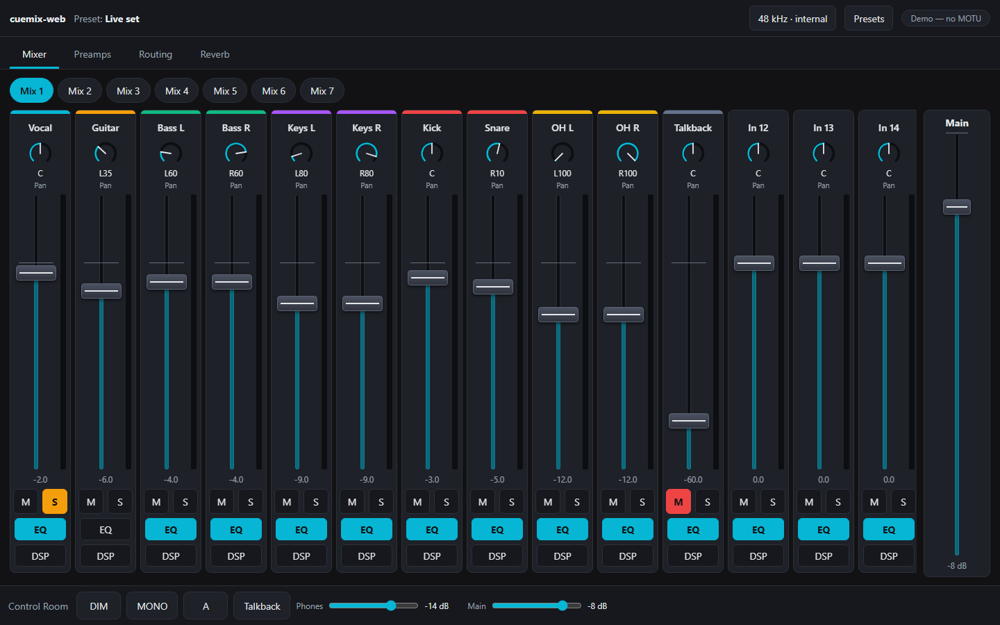
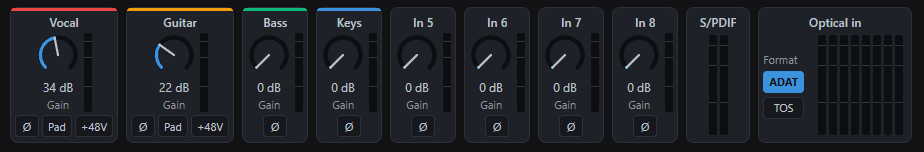

# cuemix-web

High-performance **Rust** web controller and bidirectional **OSC** bridge for the **MOTU UltraLite-mk5** audio interface. A single Rust binary embeds a dark-theme Svelte web UI and serves it together with a WebSocket API. OSC controllers (TouchOSC, QLab, ...) and browsers share one state core, so every change made from either side is applied, clamped and broadcast back to all clients.

**Status:** in daily use on a real UltraLite-mk5 (firmware 2.0.8). The device is identified on connect, its whole state is read back, levels are metered, and the mixes, preamps, trims and monitoring are controlled. DSP, reverb and clock are read from the card; writing them is enabled one feature at a time after a test on a card.



| Input | Output |
|---|---|
|  |  |

## Hardware coverage

Source of truth: [`docs/ARCHITECTURE.md`](docs/ARCHITECTURE.md) §8 (Q3) and [`docs/MOTU-PROTOCOL.md`](docs/MOTU-PROTOCOL.md). The property layouts come from a real connect dump and from CueMix 5's own property table.

- **Read and written:** preamp gain and phase (8 inputs), pad and +48 V (2 mic inputs), main volume (verified on a card), phones level, analog output trims (outputs 1–10, in the device's DAC order), mono, talkback, mix faders, pan, mute and solo (written with the layout read from the device; a stereo strip moves both halves of its pair), optical input/output format (ADAT / TOSLINK).
- **Metered:** every mixer input (after the input DSP), each preamp (before the DSP), every analog output and the phones (before the trim), S/PDIF and optical inputs. One byte per point, −0.5 dB per step, about 30 updates per second.
- **Read from the device, not written yet:** input EQ (analog inputs 1–8, 4 bands: type, on/off, frequency, gain, Q), compressor (inputs 1–8), gate (mic 1–2), output EQ (12 outputs, 3 bands), reverb (decay, damping, pre-delay, width, preset), sample rate and clock source. The UI shows the card's settings and says when a change is not sent yet. Reverb sends are the Reverb mix faders and the reverb return is the "Reverb" mixer input pair in every mix.
- **Detected on connect:** model, firmware, channel counts, stereo pairs and the CueMix 5 channel/mix names (the UI sizes itself to the device).
- **Known but not implemented:** routing (prop 5010: one source per output; the mixes cover normal use), A/B speakers (5015–5017), talkback settings (5026–5031), loopback source (5014). DIM has no hardware property. There is no global EQ bypass on the hardware: on/off is per band.

## Features

- Web UI for mixes, channel faders, pan, mute/solo, preamps (gain, +48 V, pad, phase), digital inputs, input DSP (EQ, compressor, gate), output trims and EQ (with presets such as *Voice clarity* or *Night*), reverb, control room and clock, with level meters everywhere.
- Presets stored on the server, plus **Export to file / Import file** to keep or share every setting as one JSON file.
- Update notice in the UI, by release channel (stable or pre-release), with a user-triggered **Install** (see [Updating](#updating)).
- Bidirectional OSC over UDP `:8000` with 1-based indices (TouchOSC / QLab friendly), with feedback to every controller.
- One state core: all changes go through a single `Param` type, are clamped, then broadcast to Web and OSC clients. The engine never echoes a change back to the client that sent it.
- Native units in state, presets and JSON (`gain` for mix faders, `db` for main, phones and preamps). The `0..1` fader position exists only at the edges: OSC and the UI fader.
- Hardware-priority sync: on (re)connection the device pushes its full state, which is applied and broadcast. The server never writes its own state back to the device on reconnect.
- Per-parameter throttle toward the device (40 msg/s by default, last value always sent).
- Device discovery: explicit IP, then mDNS (provisional), then the ARP table plus a TCP probe.
- Offline demo mode when the device is absent, plus presets and channel labels.
- Single binary with the UI embedded (`rust-embed`), running as non-root.

## Build from source

Prerequisites:

- Rust **1.85** or newer (MSRV, edition 2021)
- Node.js **22**
- GNU `make` (optional, but the recommended entry point)

**Build the frontend before cargo.** The binary embeds `frontend/dist/` at compile time, and `cargo build` does not build the UI for you. Always run the frontend build first, or use `make`, whose targets enforce the order.

```sh
make frontend          # cd frontend && npm ci && npm run build  -> frontend/dist/
cargo build --release  # or simply: make backend (depends on frontend)
```

Without make:

```sh
cd frontend && npm ci && npm run build && cd ..
cargo build --release
```

### Make targets

| Target | What it does |
|---|---|
| `make` / `make all` | Build the frontend, then the release backend |
| `make frontend` | Build the Svelte UI into `frontend/dist/` |
| `make backend` | Build the frontend, then `cargo build --release` |
| `make test` | Build the frontend, then `cargo test --workspace` |
| `make lint` | Build the frontend, then `cargo fmt --check` and `cargo clippy --all-targets --locked -- -D warnings` |
| `make fmt` | `cargo fmt --all` |
| `make check-secrets` | Run `gitleaks detect` against the repository |
| `make clean` | Remove `target/`, `frontend/dist/` and `frontend/node_modules/` |
| `make help` | List all targets with their descriptions |

## Configuration

Copy the example and adjust it locally:

```sh
cp config.example.toml config.toml   # config.toml is git-ignored
```

Config file search order (first match wins):

1. `--config <path>` on the command line
2. `$CUEMIX_CONFIG`
3. `./config.toml`
4. `/etc/cuemix-web/config.toml`

A missing file means built-in defaults (zero-config start). An invalid file is an error; an unknown key is logged as a warning at startup (so typos are visible, and an older binary still starts with a newer config).

Environment overrides:

| Variable | Overrides |
|---|---|
| `CUEMIX_CONFIG` | Path of the config file (step 2 above) |
| `CUEMIX_HTTP_BIND` | `[network] http_bind` (HTTP/WebSocket listen address) |
| `CUEMIX_OSC_LISTEN` | `[network] osc_listen` (UDP OSC listen address) |
| `CUEMIX_MOTU_IP` | `[motu] ip` (device address; empty means auto-discovery) |

Main sections of `config.example.toml`: `[network]` (listen addresses, feedback targets, MOTU interface, mDNS name), `[motu]` (device IP and WebSocket port), `[engine]` (throttle, sync policy, offline fallback), `[storage]` (presets and labels paths), `[web]` (trust of `X-Forwarded-*` headers).

## Running

```sh
cuemix-web --config config.toml          # or: cargo run --release -- --config config.toml
RUST_LOG=debug cuemix-web --config config.toml   # default level is info
cuemix-web --help                        # usage and environment variables
cuemix-web --version
```

Once running:

- Web UI: `http://127.0.0.1:8080`, or `http://cuemix-web.local:8080` when mDNS is available on the network.
- Health check: `curl http://127.0.0.1:8080/api/health` returns `{"status":"ok","version":…}`.
- OSC: UDP `:8000`.
- Without a MOTU on the network, the server starts in **demo mode**: state is kept in memory and commands are accepted but not sent to any device.
- Presets and labels are stored under `[storage]`. The example points to `/var/lib/cuemix-web/`, so create that directory or change the paths in `config.toml`.

## Web UI

The embedded Svelte 5 console (dark theme) has four views, each reachable directly with a URL fragment (`#mixer`, `#input`, `#output`, `#reverb`):

- **Mixer**: one tab per mix (Main 1-2, Phones, Line 3-4 … Reverb, in CueMix 5 order), one strip per input or stereo pair (pan, fader, meter, mute/solo, DSP drawer on the analog inputs), the Main volume with the selected mix's output meter.
- **Input**: mic and line preamps with their meters, S/PDIF and optical inputs (ADAT/TOS).
- **Output**: monitor and phones levels, mono, A/B, talkback, output trims per pair, and the output EQ (curve on the left, bands on the right, presets).
- **Reverb**: reverb settings, sends (the Reverb mix) and returns.

The DSP drawer and the output EQ follow CueMix 5: a curve with draggable bands, and per band an on/off button, frequency, gain, Q and the filter types the hardware offers on that band. Faders: double-click/tap resets to 0 dB, Shift-drag is fine adjustment, mouse wheel nudges. Controls whose changes are not sent to the MOTU yet get a dashed outline and a tooltip. A diagnostic **Meter probe** view (`/?probe`) shows the card's raw meter points.


```sh
cd frontend && npm install
npm run dev      # Vite dev server, proxies /ws and /api to 127.0.0.1:8080
npm test         # vitest
npm run check    # svelte-check
npm run build    # outputs frontend/dist (embedded into the binary)
```

## OSC quick reference

UDP `:8000`. **Indices are 1-based on the wire** (the server converts them to 0-based internally).

| Address | Argument | Parameter (conversion) |
|---|---|---|
| `/mix/{bus}/ch/{ch}/vol` | float `0..1` | `mix_vol` → `gain = (p/0.75)^K`, K ≈ 4.8024; `0.75` = 0 dB, `1.0` = +12 dB |
| `/mix/{bus}/ch/{ch}/pan` | float `-1..1` | `mix_pan` (not mapped to hardware yet) |
| `/mix/{bus}/ch/{ch}/mute` · `/solo` | int/float/bool | `mix_mute` · `mix_solo` |
| `/mix/main/vol` | float `0..1` | `main_vol` → `db` (trim: `1.0` = 0 dB, `0` = −100 dB) |
| `/preamp/{ch}/gain` | float dB `0..74` | `preamp_gain` (`db`) |
| `/preamp/{ch}/48v` · `/pad` · `/phase` | int | `phantom` · `pad` · `phase` |
| `/eq/{ch}/band/{b}/mode` · `/bypass` | int | `input_eq_mode` (raw type: 0 bell, 2 shelf?, 3 high-pass) · `input_eq_bypass`; `ch` 1–8, `b` 1–4 |
| `/eq/{ch}/band/{b}/freq` · `/gain` · `/bw` | float | `input_eq_freq` (Hz) · `input_eq_gain` (dB) · `input_eq_bw` (octaves) |
| `/output/{n}/eq/band/{b}/mode` · `/bypass` · `/freq` · `/gain` · `/bw` | int / float | `output_eq_*`, same units; `n` 1–12, `b` 1–3 |
| `/comp/{ch}/bypass` | int | `comp_bypass` (1 = bypassed); `ch` 1–8 |
| `/comp/{ch}/threshold` · `/attack` · `/release` · `/ratio` · `/makeup` | float | `comp_*`: dB · ms · ms · `n:1` · linear gain (1.0 = 0 dB) |
| `/gate/{ch}/bypass` · `/threshold` · `/attack` · `/release` | int / float | `gate_*` (1 = bypassed, dB, ms, ms); `ch` 1–2 |
| `/reverb/decay` · `/damping` · `/predelay` · `/width` | float `0..100` | `reverb_decay` · `reverb_damping` · `reverb_predelay` (ms) · `reverb_width` |
| `/reverb/preset` | int | `reverb_preset` (raw number) |
| `/clock/rate` | int Hz | `sample_rate` (44100 … 192000) |
| `/clock/source` | string | `clock_source`: `internal`, `spdif`, `optical` |
| `/routing/in/{in}/out/{out}` | int | `route` |
| `/controlroom/dim` · `/mono` · `/ab` · `/talkback` | int | `dim` · `mono` · `speaker_b` · `talkback` |
| `/controlroom/phones/vol` | float `0..1` | `phones_vol` (trim; extension to the original spec, needed by the Control Room bar) |
| `/output/{n}/trim` | float `0..1` | `output_trim` of analog output `n` (1–10; trim law like the phones) |
| `/preset/load` | string | `load_preset`, by name |
| `/sync` | none | the bridge replies with a full feedback dump to the sender (rate-limited to 1/s) |

Bridge behaviour:

- Any peer that sends a valid message is registered (TTL 10 min, max 64 peers) and receives a **full state dump** on its first message.
- Feedback (`changed`) goes to the configured feedback targets and registered peers, **except the sender** (no echo).
- Bundles are split at 8 KiB.
- Not sent over OSC: `presets`, `labels`, `meters`, `status`, `session`, `error`.
- Non-finite floats (NaN, inf) are rejected before conversion. Index `0`, a non-numeric index, or an out-of-range index is rejected.

Boolean inputs accept `int` (non-zero is on), `float` (`>= 0.5` is on), or `T`/`F`. Feedback sends booleans as `int` 0/1 and continuous values as `float`.

## WebSocket JSON quick examples

Endpoint `/ws`. Indices are **0-based** in JSON, and values use the native units:

- mix fader `gain`: linear, `0.0..=3.98107` (+12 dB), `1.0` = 0 dB
- `db` for main and phones: integer `-100..=0`
- `db` for preamp gain: integer `0..=74`
- `value` for pan: `-1.0..=1.0`

```json
{"cmd":"set","param":"mix_vol","bus":0,"ch":3,"gain":1.0}
{"cmd":"set","param":"main_vol","db":-12}
{"cmd":"set","param":"preamp_gain","ch":0,"db":30}
{"cmd":"set","param":"phantom","ch":0,"on":true}
{"cmd":"load_preset","name":"live"}
{"cmd":"save_preset","name":"live"}
{"cmd":"import_preset","name":"from file","text":"{\"schema_version\":2,\"state\":{…}}"}
{"cmd":"list_presets"}
{"cmd":"set_label","ch":2,"label":{"name":"Vox","color":"#06B6D4"}}
```

On connection the server sends `snapshot`, `labels` and `presets`. Later events:

```json
{"event":"changed","params":[{"param":"dim","on":true}]}
{"event":"status","connection":"online"}
{"event":"session","active_preset":"live","modified":true,"connection":"online"}
{"event":"presets","names":["default","live"]}
{"event":"labels","channels":{"2":{"name":"Vox","color":"#06B6D4"}}}
{"event":"meters","levels":[0.0,0.12]}
{"event":"error","message":"..."}
```

`meters` is limited to 60 per second per client. Incoming messages are capped at 256 KiB. `import_preset` stores the JSON it carries (the preset file format, any readable version) as `<name>.json`, then recalls it like `load_preset`. The server does not send a `changed` back to the client that caused it.

## Deployment

Release assets (`v*.*.*` tags) are built by `.github/workflows/release.yml`: static musl tarballs `cuemix-web-<tag>-<target>.tar.gz` and `.deb` packages, each with a `.sha256`, for `x86_64`, `aarch64` and `armv7` musl targets. Run the setup scripts from a checkout of this repository, as root.

- **Proxmox VE (LXC)**: `sudo deploy/proxmox-setup.sh`. Creates a Debian 12 container with a LAN address and an isolated MOTU bridge (no gateway, container side `169.254.254.1/16`), installs the latest release, and enables the `cuemix-web` service. Optional answers can go in `deploy/proxmox.env` (copy `deploy/proxmox.env.example`). Use `--dry-run` to preview. The bridge is defined in `/etc/network/interfaces.d/cuemix-motu.cfg`; if `/etc/network/interfaces` does not load it, the script offers to append `source /etc/network/interfaces.d/cuemix-motu.cfg` (keeping a backup) and stops if you decline.
- **Raspberry Pi / SBCs / Linux**: `sudo deploy/linux-setup.sh`. Detects the architecture, installs the release (binary taken from the `.deb` on Debian/Ubuntu, from the tarball otherwise), creates the `cuemix` service user, and sets up the systemd unit and the udev rule that gives the MOTU link `169.254.254.1/16`. Settings can go in `deploy/linux-setup.env`. `--uninstall` removes the installed pieces but keeps `/etc/cuemix-web` and `/var/lib/cuemix-web`.
- **Docker**: `deploy/docker-compose.yml` uses **host networking**, which the link-local discovery and OSC UDP require. Images are multi-arch and run as the distroless `nonroot` user.
- **Reverse proxy**: the `/ws` WebSocket needs an upgrade-aware proxy. Forward `X-Forwarded-For` and `X-Forwarded-Host` (used for the client address and the Origin check), and set `[web] trust_forwarded_headers = true` and `allowed_origins` in `config.toml`. If the proxy passes the `Host` header through unchanged, neither setting is needed.
- **HTTPS**: cuemix-web serves plain HTTP only (by design); terminate TLS at the reverse proxy. The UI switches to `wss://` by itself when loaded over `https://`. Two common pitfalls: the proxy's backend must **not** use TLS towards cuemix-web (e.g. HAProxy "Encrypt(SSL)" unchecked), and idle WebSockets need a long tunnel timeout (HAProxy: `timeout tunnel 1h`), otherwise the UI reconnects every ~30 s.

Both scripts are idempotent: an existing `config.toml` is never overwritten. The service is `deploy/cuemix-web.service`, and the udev rule template is `deploy/99-motu-mk5.rules.template`.

## Updating

Updates are never automatic. The running version is shown at the bottom right of the web UI and by `cuemix-web --version`. Release notes: [GitHub Releases](https://github.com/lejeanf/cuemix-web/releases) and [`CHANGELOG.md`](CHANGELOG.md).

**From the web UI.** The setup scripts install two small root systemd units next to the service. `cuemix-update-check.timer` checks GitHub once a day and writes the result to `/var/lib/cuemix-web/update-status.json`. When a newer release exists in the configured channel, the UI shows **vX available** next to the version, with the release notes and an **Install** button. Pressing it only creates `/var/lib/cuemix-web/update-request`; `cuemix-update-request.path` sees that file and runs `cuemix-update` as root, with every safety check below, and the page reconnects to the new version. The web service itself stays unprivileged and never downloads anything.

**Channels** are chosen in `config.toml`, not in the UI (anyone who can open the UI could otherwise switch a device to pre-releases):

```toml
[update]
channel = "stable"        # published releases (vX.Y.Z)
# channel = "prerelease"  # newest release, alphas/betas included (vX.Y.Z-alpha.N)
```

**From a shell.** **Raspberry Pi / Linux** (installed by `linux-setup.sh`):

```bash
sudo cuemix-update --check      # installed vs latest; exit 10 if an update is available
sudo cuemix-update              # install the latest stable release
sudo cuemix-update --pre        # include release candidates
sudo cuemix-update --version v0.3.0   # pin an exact version (up or down)
sudo cuemix-update --rollback   # go back to the previous binary
```

**Proxmox VE** (from the host, in your checkout): `sudo deploy/proxmox-setup.sh --update` (same `--pre` / `--version` flags, `--ctid N` to pick the container). It refreshes `cuemix-update` and the update units inside the container, then updates the binary; bridges, udev and the container config are not touched. Inside the container, `cuemix-update` works as above (`pct exec <CTID> -- cuemix-update`).

**Docker**: `docker compose pull && docker compose up -d` (or pin a version tag such as `ghcr.io/lejeanf/cuemix-web:0.3.0` in `docker-compose.yml`). `latest` only follows stable releases.

How an update stays safe:

- The download is verified (sha256) and the new binary must report the expected version before anything is replaced.
- The binary is swapped atomically; the previous one is kept as `/usr/local/bin/cuemix-web.prev`.
- After the restart, `/api/health` must answer with the new version within 15 s — otherwise the previous binary is restored automatically and the last service logs are printed.
- `config.toml`, presets and labels are never touched. Presets carry a format version: presets saved by older versions keep loading; a preset saved by a newer version is refused with a clear message (after a rollback) instead of being misread. Unknown keys in `config.toml` (e.g. written for a newer version) are logged as warnings, not fatal.

`cuemix-update` exit codes: `0` updated or already up to date, `10` update available (`--check`), `1` error (nothing changed), `2` usage error, `4` another update is running, `5` update failed and was rolled back, `6` rollback failed (manual attention needed).

## Security

- Never commit `config.toml`, `*.local.toml`, `deploy/*.env`, `.env`, keys, or `data/` contents (labels and presets). All are git-ignored, and `make check-secrets` / CI run gitleaks with a rule that blocks RFC1918 addresses.
- Committed examples use only `192.0.2.x` (documentation range), `127.0.0.1`, and link-local `169.254.x.x`. Put real addresses only in local, git-ignored files.
- The server runs as a non-root user, and production code avoids `unwrap`/`expect` (enforced by a clippy lint).

## Documentation

- [`docs/ARCHITECTURE.md`](docs/ARCHITECTURE.md) (in French): living technical source of truth covering module map, contracts, protocol details and decision log. Structural changes must update it together with this README.
- [`docs/MOTU-PROTOCOL.md`](docs/MOTU-PROTOCOL.md) (in French): hardware protocol findings, from a real connect dump, meter-probe sessions and CueMix 5's property table; open questions are listed there and in ARCHITECTURE §8.
- [`docs/CUEMIX-CAPTURE.md`](docs/CUEMIX-CAPTURE.md): how to capture CueMix 5's traffic, for anything still unknown.
- [`docs/HANDOFF.md`](docs/HANDOFF.md): original project specification (v12.0.0).

## License

MIT
